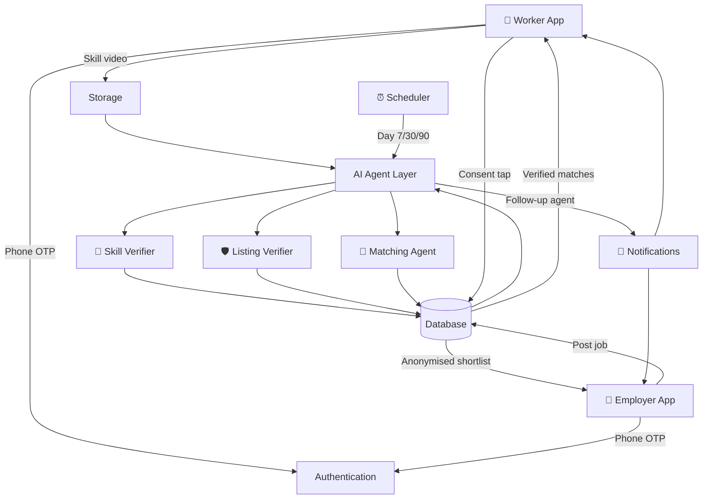

# RURAL-CONNECT
# 🌾 KaamSetu

### *We replace the relative's recommendation with verified proof.*

An AI-powered mobile web app concept that connects rural youth with **verified local jobs**, using verified listings, video-based skill proof, and consent-based matching.

> 📍 **Status:** Idea and research stage (hackathon submission). No working prototype yet.

---

## 📌 Problem

- Young rural workers (school, ITI or college qualified) cannot find work that matches their skills, location and income needs.
- Small employers take **2-3 months** to hire by word of mouth, and **40-50%** of hires fail within three months.
- Jobs travel through relatives, forwards and agents.
- Workers lose money to **fake listings and unpaid wages**.

**Root cause:** the gap is trust, not job supply. Employers can't judge a stranger's skills, and workers can't tell real jobs from scams.

---

## 🔬 Research insights

| Evidence | Insight | How KaamSetu responds |
|---|---|---|
| A randomised trial of a government-backed job app for rural trainees [1] | The platform was hard to use, had few job ads, and had no effect on job search or employment | Voice-first, regional-language design and verified, plentiful listings |
| Study of India's labour market [2] | Demand exists for semi-skilled labour, but young people struggle to acquire the skills employers want | Skill verification from video, so skills become visible proof |
| Six-year Uganda field experiment [3] | Adding matching to training backfired, plausibly because of low callback rates | Verified skill proof to raise employer callbacks, plus follow-ups to keep workers engaged |
| Place-based approach for rural youth [4] | Local coordination among government, civil society and employers is key | ITIs, panchayats and placement agents as partners |

---

## 💡 Proposed solution

A mobile web app (PWA) powered by four AI agents:

| Agent | Role |
|---|---|
| 🛡️ **Listing Verifier** | Flags scam signals (upfront fees, unrealistic wages, duplicate phones) and blocks risky jobs before workers see them |
| 🎥 **Skill Verifier** | Scores a 30-60 second skill video against a trade-specific rubric, with evidence |
| 🎯 **Matching Agent** | Ranks jobs by skill, distance, wage and season, and explains each match |
| 🔔 **Follow-up Agent** | Checks in on day 7, 30 and 90 to reduce early exits and catch unpaid wages |

---

## 🔄 Proposed user flow

**Worker**
1. Log in with phone OTP.
2. Answer a few voice questions (location, work wanted, minimum wage, travel distance).
3. Record a skill video, and AI scores it.
4. Get ranked, verified matches.
5. Tap **Share my details** to give consent.

**Employer**
1. Post a job.
2. AI checks it for fraud.
3. See an anonymised shortlist of verified workers.
4. Contact consenting workers.
5. Get a day-30 check-in.

---

## 🏗️ Proposed architecture

**Proposed tech (to be built):** React PWA, Firebase (Auth, Firestore, Storage, Cloud Functions, Cloud Messaging, Scheduler), Gemini API for video and reasoning, Bhashini API for Indian-language voice, OpenStreetMap for distance.

---

## 🔐 Trust, ethics and safety by design

- Listings are checked **before** they reach workers.
- Worker details are shared **only with explicit, revocable consent**.
- Matching ignores name, caste, religion and gender, and shortlists are anonymised.
- Videos are deleted after scoring; only the score and evidence are kept.
- Skill scores are explained, and workers can appeal them.

---

## 👥 Stakeholders

Small employers | ITIs and skilling centres | Placement agents | Panchayats and employment schemes

---

## 🧪 Field validation plan

Before building, we plan to interview workers, employers, an ITI and a panchayat member. Questions:
1. How did young people here find their last job?
2. Why did the last hire leave within three months?
3. What does an employer check before hiring?
4. How far will a worker travel, and for what wage?
5. Has anyone been cheated by a fake listing?
6. Which skills do employers say are missing?
7. What does one bad hire cost an employer?

---

## 🎯 Target impact

| Metric | Today | Target |
|---|---|---|
| Time to hire | 2-3 months | Under 2 weeks |
| 3-month hire failure | 40-50% | Under 25% |
| Fake listings reaching workers | Common | Blocked before reaching workers |

---

## 💰 Sustainability

- Free for workers.
- Employers pay a small fee per successful hire or a subscription.
- ITIs, placement agents and panchayats act as distribution partners.

---

## 🗺️ Roadmap

1. **Validate:** field interviews and trade rubrics for 3 trades.
2. **Prototype:** Hindi and English, full verify-match-consent flow.
3. **Pilot:** with ITIs and panchayats.
4. **Reach:** SMS/IVR for feature-phone users.
5. **Scale:** more trades and languages, employer reputation score, government scheme integration.

---

## 👨‍💻 Team

| Name | Role |
|---|---|
| SHIVANI ADARAGUNCHI| AI and Agents |
| HEMANSI J PATEL| Backend |
| PRATIKSHA HANJI | Frontend and Design |
| SHILPA MASALI | Product, Research and Pitch |

---

## 📚 References

1. Chakravorty et al. (2023). *Impact of the COVID-19 Crisis on India's Rural Youth: Evidence from a Panel Survey and an Experiment.* World Development, 168. https://wrap.warwick.ac.uk/id/eprint/174376
2. *India's Labour Market Challenges: Employability of Young Workforce from the Perspective of Supply and Demand* (2024). Prospects. https://link.springer.com/article/10.1007/s11125-024-09691-y
3. Bandiera et al. (2025). *The Search for Good Jobs: Evidence from a Six-Year Field Experiment in Uganda.* Journal of Labor Economics. https://www.nber.org/papers/w31570
4. Transform Rural India Foundation / GOYN. *Rural Youth at Work: A Place-Based Approach to Connect Young India to Economic Opportunity.* https://www.trif.in/rural-youth-at-work/

**Related platforms:** [Bhashini](https://bhashini.gov.in) | [National Career Service](https://www.ncs.gov.in) | [Skill India Digital](https://www.skillindiadigital.gov.in) | [e-Shram](https://eshram.gov.in)
